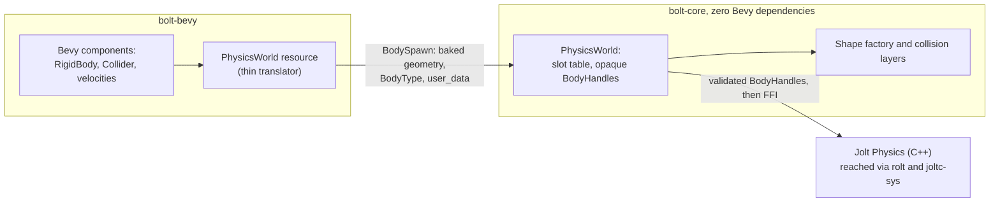

# Bolt ⚡

> ⚠️ **Work in Progress (WIP)**: This project is under active development. APIs are experimental and subject to breaking changes.

High-performance [Jolt Physics](https://github.com/jrouwe/JoltPhysics) integration for the [Bevy](https://bevyengine.org) game engine.

---

## 🧱 Architecture

Bolt is split into two crates with a strict boundary:



- **`bolt-core`** owns the physics: world lifecycle, body management, collision
  layers, and shape construction. It has **zero Bevy dependencies** and can be
  used standalone with any ECS or renderer — see
  [`bolt-examples/src/bin/headless_bench.rs`](bolt-examples/src/bin/headless_bench.rs),
  which drives core directly with no window at all.
- **`bolt-bevy`** is a thin translator: it converts Bevy component data
  (`Collider`, `RigidBody`, `Transform`) into core's vocabulary at the boundary
  and delegates. No Jolt/`rolt` type appears in its public API — the crate has
  no direct `rolt`/`joltc-sys` dependency; the FFI is reached only through
  `bolt-core`.
- Bodies are addressed by **opaque `BodyHandle`s** — they cannot be forged from
  raw bits, and the world rejects stale handles after a body is destroyed.

## 🚀 Quick Start

```rust
use bevy::prelude::*;
use bolt_bevy::prelude::*;

fn main() {
    App::new()
        .add_plugins(DefaultPlugins)
        .add_plugins(BoltPlugin::default())
        .add_systems(Startup, setup)
        .run();
}

fn setup(mut commands: Commands) {
    // A dynamic box that falls under gravity.
    commands.spawn((
        Transform::from_xyz(0.0, 4.0, 0.0),
        RigidBody::Dynamic,
        Collider::Box { half_extents: Vec3::splat(0.5) },
    ));
}
```

Run the interactive examples (always with `--release` — debug builds of Bevy
are 10–50× slower and will lie to you about performance):

```bash
cargo run --release -p bolt-examples --bin hello_world
cargo run --release -p bolt-examples --bin kinematic_elevator
```

---

## 🧪 Testing & Development Guide

### 1. Running Tests

#### Run all tests across the entire workspace
```bash
cargo test --workspace
```

#### Run bolt-core's unit tests (the physics runtime)
```bash
cargo test -p bolt-core --lib
```

#### Run bolt-core's integration suite (`tests/handles.rs` — the public-boundary contract)
```bash
cargo test -p bolt-core --test handles
```

#### Run bolt-bevy's integration suite (`tests/physics_loop.rs` — end-to-end ECS behavior)
```bash
cargo test -p bolt-bevy --test physics_loop
```

#### Run a single test by name
```bash
cargo test -p bolt-core test_stale_generation_handle_is_invalid
```

#### Run tests with full log/console output (`--nocapture`)
Useful for viewing `info!`, `error!`, and `warn!` tracing output:
```bash
cargo test --workspace -- --nocapture
```

### 2. Code Quality & Linting

#### Run Clippy across all targets and features
```bash
cargo clippy --workspace --all-targets --all-features -- -D warnings
```

#### Check documentation for broken intra-doc links (CI enforces this)
```bash
RUSTDOCFLAGS="-D warnings" cargo doc --workspace --no-deps
```

#### Check / format code
```bash
cargo fmt --all -- --check
cargo fmt --all
```

### 3. Benchmarking

The headless benchmark steps the world without a renderer — use it whenever
physics performance is in question:

```bash
cargo run --release -p bolt-examples --bin headless_bench -- 1000 1
# args: [dynamic body count] [collision substeps per step]
```

---

## 🐧 Developing on WSL

WSL2 + WSLg can silently fall back to **llvmpipe software rendering** — every
pixel rasterized on your CPU, giving the false impression that physics is slow
(12–18 fps in `hello_world`, while the engine itself uses ~2% of a frame).
Your GPU *is* reachable through Mesa's Dozen (`dzn`) D3D12→Vulkan bridge, but
two things block it by default:

1. **`dzn` needs `libclc`** (and `vulkan-tools` to inspect with `vulkaninfo`):
   ```bash
   sudo pacman -S libclc vulkan-tools   # Arch-based WSL images
   ```
2. **Dozen reports itself as non-conformant, and `wgpu` hides non-conformant
   adapters.** To let the real GPU through, override the render plugin
   *locally* in the example you're running (deliberately not committed — it is
   a machine-specific workaround):
   ```rust
   .add_plugins(DefaultPlugins.set(bevy::render::RenderPlugin {
       render_creation: bevy::render::settings::RenderCreation::Automatic(Box::new(
           bevy::render::settings::WgpuSettings {
               instance_flags: bevy::render::settings::InstanceFlags::default()
                   | bevy::render::settings::InstanceFlags::ALLOW_UNDERLYING_NONCOMPLIANT_ADAPTER,
               ..Default::default()
           },
       )),
       ..Default::default()
   }))
   ```

Verify with `vulkaninfo --summary` (look for your GPU, not llvmpipe) or by
checking the `AdapterInfo` line Bevy logs at startup.

---

## 🛠️ Prerequisites

- **Rust Toolchain**: edition 2024, stable ≥ 1.95.
- **C++ Compiler / Standard Library**:
  - **Linux**: `g++` or `clang++` with `libstdc++`
  - **macOS**: Xcode Command Line Tools (`libc++`)
  - **Windows**: MSVC build tools or MinGW (`libstdc++`)
